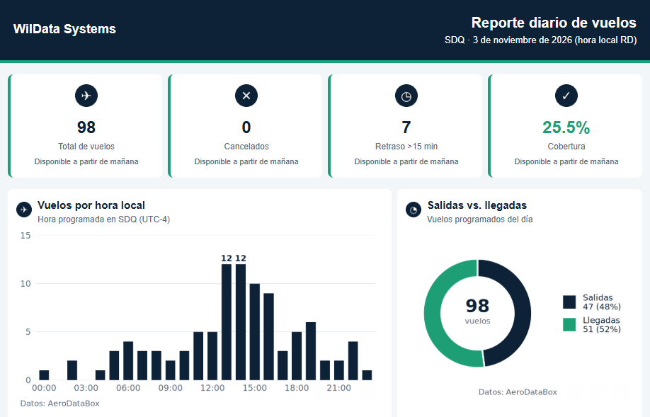
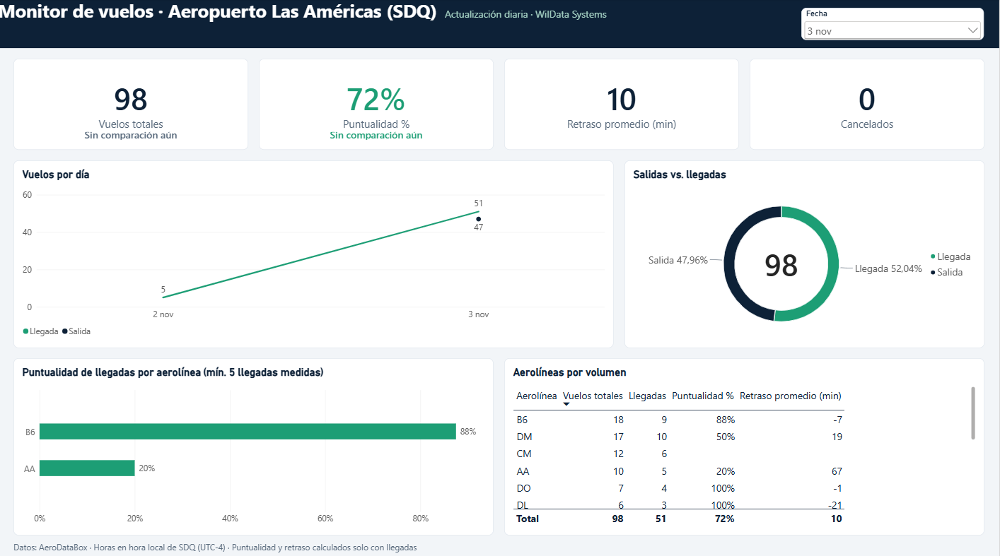
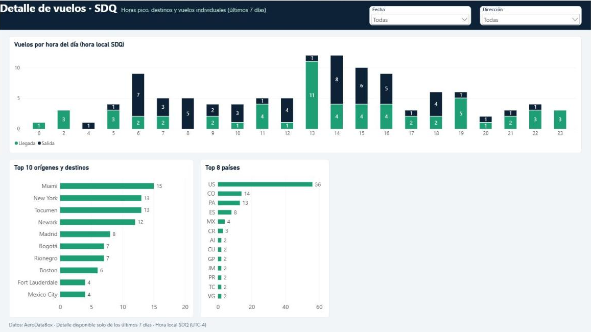

# Monitor de Vuelos SDQ

> **English summary.** An automated R pipeline that collects flight data for Santo Domingo's
> Las Américas airport (SDQ) from the AeroDataBox API, stores it in MariaDB, and produces a daily
> HTML email report, failure alerts, and CSV files for a Power BI dashboard. Flight detail is
> deleted on a schedule designed to stay under a 7-day retention limit. This repository contains
> code and sample screenshots, with no flight data files or credentials.

Proyecto de portafolio de **WilData Systems**. Este repositorio contiene el código y capturas de
ejemplo: **no incluye archivos de datos de vuelos ni credenciales**. Las capturas muestran cifras
agregadas reales de pocos días, por lo que no sirven para evaluar a una aerolínea.

## El problema

Una pantalla de vuelos muestra lo que pasa ahora, pero no responde preguntas como cuántos vuelos
operó el aeropuerto ayer, qué aerolíneas salieron a tiempo o cómo cambia la operación día a día.
Este proyecto guarda esa información, la resume cada día y la entrega sin intervención manual.

## Arquitectura

```text
API AeroDataBox
      │  load_fids.R (4 veces al día)
      ▼
MariaDB: flight_movements (detalle temporal)
      │  daily_summary.R
      ▼
MariaDB: daily_summary (agregados permanentes)
      │
      ├─ send_report.R ──► reporte HTML por correo
      └─ export_csv.R ───► CSV ──► Power BI en la nube
                            └─ archive_csv.R ──► copias diarias

run_job.sh + send_alert.R ──► alerta por correo si un job falla
check_freshness.R ─────────► alerta si dejan de llegar datos
purge.R ───────────────────► borra el detalle antiguo
```

**Tecnologías:** R (`httr2`, `jsonlite`, `DBI`, `RMariaDB`, `ggplot2`, `blastula`, `htmltools`,
`curl`), MariaDB, cron y `flock`.

| Archivo | Función |
|---|---|
| `load_fids.R` | Descarga los vuelos y los inserta o actualiza en `flight_movements` |
| `daily_summary.R` | Calcula los agregados por día, dirección y aerolínea |
| `send_report.R` | Envía el reporte HTML con gráficos |
| `export_csv.R` | Genera `daily_summary.csv` y `flights_detail_7d.csv` con un usuario de solo lectura |
| `archive_csv.R` | Guarda copias diarias y borra las copias antiguas de detalle |
| `purge.R` | Borra el detalle y los JSON crudos antiguos |
| `check_freshness.R` | Avisa si no llegan datos nuevos |
| `run_job.sh` | Ejecuta cada job, guarda su log y dispara la alerta si falla |
| `send_alert.R` | Envía la alerta, con el log censurado, como máximo una vez al día por job |

## Horario (ejemplo de cron)

Horas en UTC. República Dominicana está en UTC-4 todo el año.

```cron
MONITOR_VUELOS_HOME=/opt/monitor-vuelos

# Descarga a las 00, 06, 12 y 18 (hora de RD), seguida de la purga
0 4,10,16,22 * * * cd /opt/monitor-vuelos && /usr/bin/flock -n logs/vuelos.lock /bin/sh -c './run_job.sh load_fids; ./run_job.sh purge'

# 07:00 en RD: resumen, reporte, purga y control de datos
0 11 * * * cd /opt/monitor-vuelos && /usr/bin/flock -w 1800 logs/vuelos.lock /bin/sh -c './run_job.sh daily_summary && ./run_job.sh --timeout 300 send_report; ./run_job.sh purge; ./run_job.sh --timeout 180 check_freshness'

# 07:20 en RD: export, publicación de los CSV y archivo
20 11 * * * cd /opt/monitor-vuelos && /usr/bin/flock -w 1800 logs/vuelos.lock /bin/sh -c './run_job.sh --timeout 300 export_csv && install -m 640 data/powerbi/daily_summary.csv data/powerbi/flights_detail_7d.csv /var/www/monitor-vuelos/; ./run_job.sh --timeout 300 archive_csv'
```

`flock` evita que dos jobs corran a la vez. El `;` antes de `purge` y de `archive_csv` hace que el
borrado corra aunque falle el paso anterior.

## Reglas de negocio

Un **día** es la fecha local de RD de la hora programada del vuelo en SDQ.

- **Retraso:** mejor hora conocida en SDQ menos hora programada. Se usa la hora de pista si ya
  había ocurrido al descargar el dato; si no, la hora revisada.
- **Hora de pista, no de puerta:** en llegadas subestima el retraso (por el rodaje de entrada) y en
  salidas lo sobreestima (por el rodaje de salida).
- **A tiempo:** retraso de **15 minutos o menos**. Un vuelo cuenta como retrasado con **más de 15
  minutos**.
- **Puntualidad:** vuelos con dato de retraso y retraso de 15 minutos o menos, entre vuelos con dato
  de retraso. **Incluye salidas y llegadas juntas** en la cifra global y en el gráfico por aerolínea;
  la tabla de ranking las separa por dirección. El dashboard de Power BI, en cambio, calcula
  puntualidad y retraso **solo con llegadas**.
- **Cancelados y desviados:** se cuentan en el total, pero no entran en las métricas de retraso.
- **Retrasos de más de 12 horas (720 min):** suelen ser vuelos reprogramados. Se excluyen del
  **promedio y del máximo** de retraso, y se cuentan aparte en `flights_delayed_720`. **Siguen
  contando como retrasados** en la puntualidad.
- **Cobertura:** vuelos con dato de retraso / (total - cancelados - desviados).

## Retención de datos de AeroDataBox

El diseño sigue una lectura estricta de un límite de **7 días contados desde la primera descarga**,
no desde la fecha del vuelo. `daily_summary` guarda solo agregados y es permanente.

| Datos | Regla | Margen aproximado |
|---|---|---|
| `flight_movements` y `raw/` | Se borran a los 6 días, con purga hasta cada 6 horas | 18 h |
| CSV de detalle publicado | Solo filas de los últimos 5 días, reemplazado a diario | 28 h |
| `archivo/detalle/` | Se borran las copias de más de 4 días | 29 h |

Los márgenes suponen que los jobs corren a tiempo. El de `archivo/detalle/` depende de cuánto antes
del vuelo se descarga una fila (hasta 11,5 horas en la medición disponible). Toda copia en otro
sistema, incluido el modelo de Power BI, debe actualizarse a diario para respetar el mismo límite.

Este proyecto no sustituye la lectura de los términos de AeroDataBox. Revisar los vigentes antes de
usarlo o de publicar datos.

## Atribución

**Datos: AeroDataBox.** La atribución aparece en los gráficos y en el pie del reporte.

## Qué NO incluye

- Archivos de datos de vuelos, CSV ni respuestas crudas de la API.
- Credenciales: `.Renviron.example` tiene solo valores de ejemplo.
- Configuración de un servidor real.

## Puesta en marcha

1. Copiar el proyecto a `/opt/monitor-vuelos`, o definir `MONITOR_VUELOS_HOME` con otra ruta.
2. Instalar R y los paquetes listados arriba.
3. Crear la base `vuelos_rd`, un usuario de lectura y escritura y otro de solo lectura. Ejecutar los
   archivos de `sql/` en orden.
4. Copiar `.Renviron.example` a `.Renviron`, completar los valores y limitar sus permisos
   (`chmod 600 .Renviron`).
5. Crear la carpeta `logs/`, probar con `Rscript send_report.R --dry-run` y agregar el cron.

Para otro aeropuerto, ajustar `AIRPORT` y `UTC_OFFSET_HOURS`. `FIRST_FULL_DAY`, en `send_report.R`,
es la primera fecha con captura completa. `assets/logo.png` es opcional.

## Capturas

### Reporte diario por correo



### Dashboard: resumen



### Dashboard: detalle


